# GameZone — Tienda online de videojuegos

**Evaluación Final Transversal · Desarrollo Frontend I (PFY2201) · Duoc UC**
Autor: **Fernando Fuentes Allende** — Analista Programador Computacional

Sitio web para una tienda de videojuegos construido con **HTML5, CSS3, JavaScript, Bootstrap 5 y React 18** (con Vite). Muestra el catálogo en tarjetas generadas dinámicamente, permite filtrar por categoría, agregar y eliminar videojuegos, y contactar a la tienda mediante un formulario validado.

- **Sitio publicado:** https://blazeman1.github.io/Frontend.EFT.React/
- **Repositorio:** https://github.com/Blazeman1/Frontend.EFT.React


---

## Contenido

1. [Funcionalidades](#funcionalidades)
2. [Tecnologías](#tecnologías)
3. [Instalación y ejecución](#instalación-y-ejecución)
4. [Guía de uso](#guía-de-uso)
5. [Estructura del proyecto](#estructura-del-proyecto)
6. [Arquitectura de componentes, state y props](#arquitectura-de-componentes-state-y-props)
7. [Cumplimiento de los requerimientos del caso](#cumplimiento-de-los-requerimientos-del-caso)
8. [Pruebas y compatibilidad](#pruebas-y-compatibilidad)
9. [Publicación en GitHub Pages](#publicación-en-github-pages)
10. [Solución de problemas](#solución-de-problemas)

---

## Funcionalidades

| Funcionalidad | Descripción |
|---|---|
| **Catálogo dinámico** | 12 videojuegos definidos en un objeto JavaScript (`src/data/videojuegos.js`). Las tarjetas (imagen, nombre, categoría, precio y descripción) se generan desde ese objeto; ninguna está escrita a mano en el HTML. |
| **Carga asíncrona** | Un servicio simula una API: entrega los datos con una pequeña demora. Mientras tanto se muestra un esqueleto de carga; si falla, aparece un mensaje con botón **Reintentar**. |
| **Filtro por categoría** | Botones (tablet/escritorio) o menú desplegable (móvil) con la cantidad de juegos de cada categoría. Se combina con una **búsqueda por nombre** que ignora tildes ("cronicas" encuentra "Crónicas"). |
| **Agregar y eliminar** | En **Modo administrador** aparece un formulario validado para agregar videojuegos (con vista previa en vivo) y un botón **Eliminar** con confirmación en cada tarjeta. **Restablecer** recupera el catálogo original. |
| **Formulario de contacto** | Nombre, email y mensaje. Se valida con JavaScript antes de enviar: muestra el error bajo cada campo, un resumen arriba y lleva el foco al primer campo con problemas. |
| **Secciones conectadas** | El botón **Consultar disponibilidad** de una tarjeta lleva al formulario de contacto con el mensaje ya escrito. Los atajos de categoría de la portada filtran el catálogo. Al agregar o eliminar juegos se actualizan la barra de navegación, el resumen de inicio y los filtros. |
| **Navegación** | Barra de navegación de Bootstrap fija, con menú hamburguesa en móvil y resaltado automático de la sección visible. |
| **Responsivo** | Probado desde 320 px hasta 1920 px y en 6 dispositivos emulados (ver [Pruebas](#pruebas-y-compatibilidad)). |

## Tecnologías

| Tecnología | Uso en el proyecto |
|---|---|
| **HTML5** | Etiquetas semánticas: `<header>`, `<nav>`, `<main>`, `<section>`, `<article>`, `<aside>`, `<address>`, `<footer>`, `<dl>`. |
| **CSS3** | `src/styles/app.css`: variables CSS, **CSS Grid** (grilla de tarjetas), **Flexbox** (inicio, filtros, contacto), `aspect-ratio`, animaciones y `prefers-reduced-motion`. |
| **Bootstrap 5.3** | Instalado con npm. Componentes: navbar, cards, formularios (`form-control`, `form-select`, `form-switch`, `is-invalid`/`is-valid`), botones, badges, alerts, placeholders, spinner y sistema de grillas. |
| **JavaScript (ES2020+)** | Objeto de datos, funciones de validación, servicio asíncrono con `Promise` y `AbortController`, manipulación del DOM (`getElementById`, `focus`, `scrollIntoView`, `IntersectionObserver`). |
| **React 18** | Componentes funcionales, `useState`, `useEffect`, `useMemo`, `useCallback`, hooks personalizados, props y renderizado condicional. |
| **Vite 5** | Servidor de desarrollo y compilación para producción. |
| **gh-pages** | Publicación de la carpeta `dist/` en la rama `gh-pages`. |

## Instalación y ejecución

### Requisitos

- [Node.js](https://nodejs.org/) **18 o superior** (incluye npm). Verifica con `node -v`.
- [Git](https://git-scm.com/) (para clonar el repositorio).

### Pasos

```bash
# 1. Clonar el repositorio
git clone https://github.com/Blazeman1/Frontend.EFT.React.git
cd Frontend.EFT.React

# 2. Instalar dependencias (crea la carpeta node_modules/)
npm install

# 3. Ejecutar en modo desarrollo
npm run dev
```

Abre **http://localhost:5173** en el navegador. Los cambios en el código se ven al instante.

> El sitio **no funciona abriendo `index.html` con doble clic**: React y Vite necesitan un servidor. Usa `npm run dev` o `npm run preview`.

### Scripts disponibles

| Comando | Qué hace |
|---|---|
| `npm run dev` | Inicia el servidor de desarrollo en `http://localhost:5173`. |
| `npm run build` | Genera la versión de producción optimizada en `dist/`. |
| `npm run preview` | Sirve la carpeta `dist/` en `http://localhost:4173` para probar el build. |
| `npm run deploy` | Compila y publica `dist/` en la rama `gh-pages` (ver [Publicación](#publicación-en-github-pages)). |

## Guía de uso

### 1. Explorar y filtrar el catálogo

Desde la portada usa **Ver catálogo** o un atajo de **Explora por categoría**. En el catálogo elige una categoría (botones en escritorio, menú desplegable en móvil) y/o escribe en **Buscar por nombre**. Si no hay coincidencias, el botón **Ver todos los videojuegos** limpia los filtros.

| Filtro por categoría | Sin resultados |
|---|---|
| 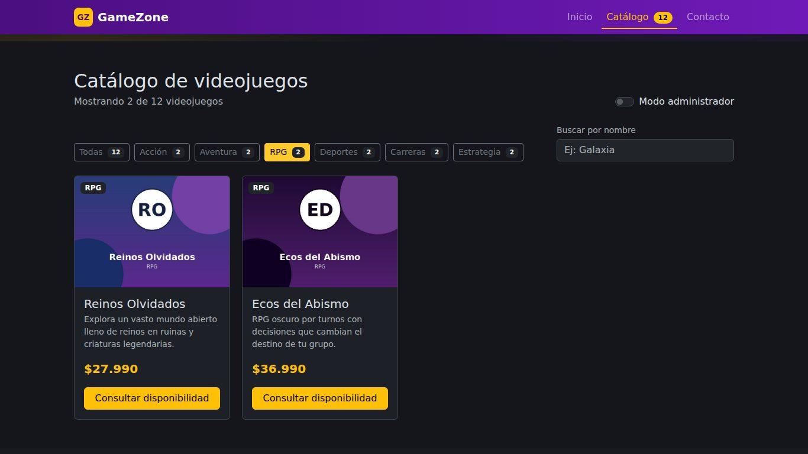 | 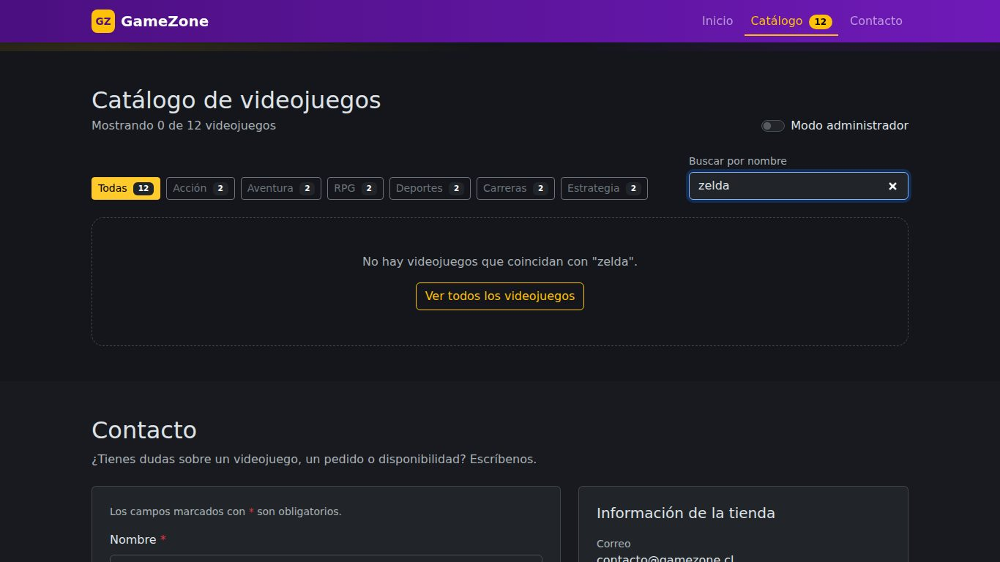 |

### 2. Consultar por un videojuego

**Consultar disponibilidad** lleva al formulario de contacto con el mensaje ya escrito y el aviso "Consulta sobre: …".

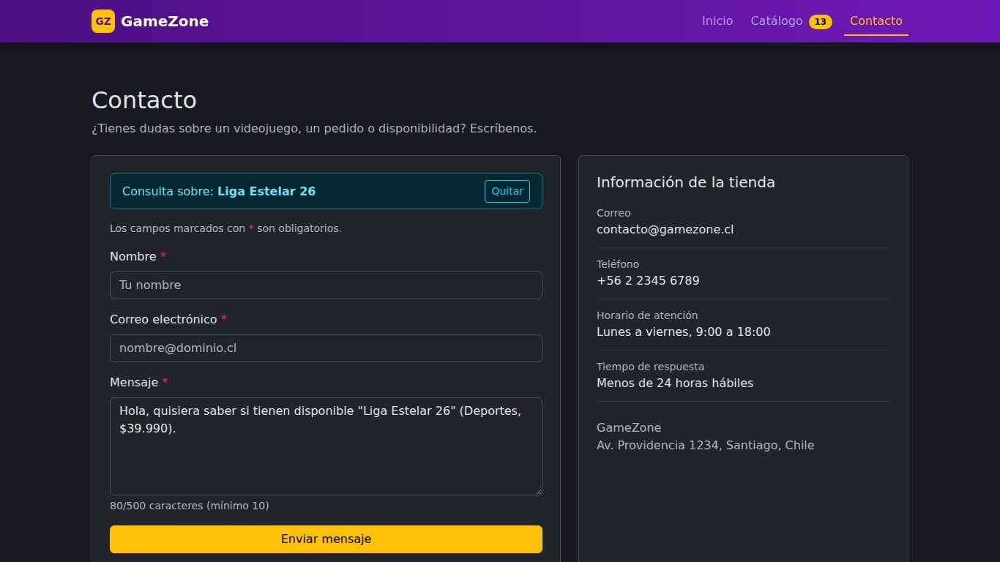

### 3. Agregar y eliminar videojuegos (Modo administrador)

1. Activa el interruptor **Modo administrador** en el catálogo.
2. Completa nombre, categoría, precio (entero, entre $1.000 y $999.990) y descripción (15 a 160 caracteres). La URL de imagen es opcional: si queda vacía o no carga, se usa una imagen por defecto.
3. La **vista previa** muestra la tarjeta mientras escribes. Pulsa **Agregar al catálogo**: el juego aparece primero con la insignia **Nuevo**.
4. Para eliminar, pulsa **Eliminar del catálogo** en una tarjeta y confirma con **Sí, eliminar**.
5. **Restablecer catálogo original** vuelve a cargar los 12 juegos iniciales.

| Validación | Vista previa | Juego agregado |
|---|---|---|
| 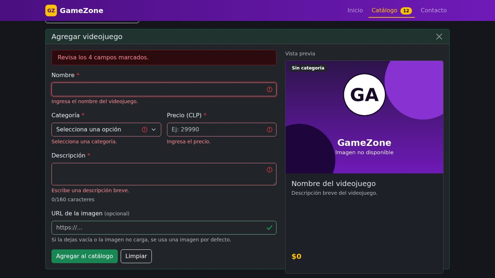 | 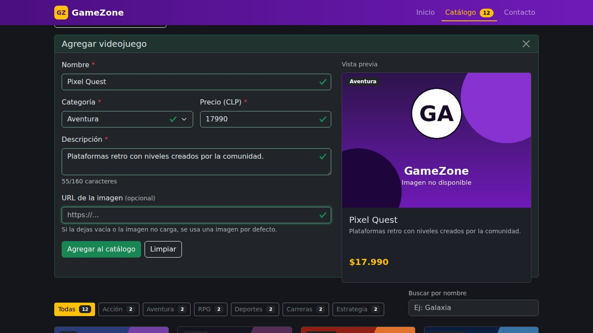 | 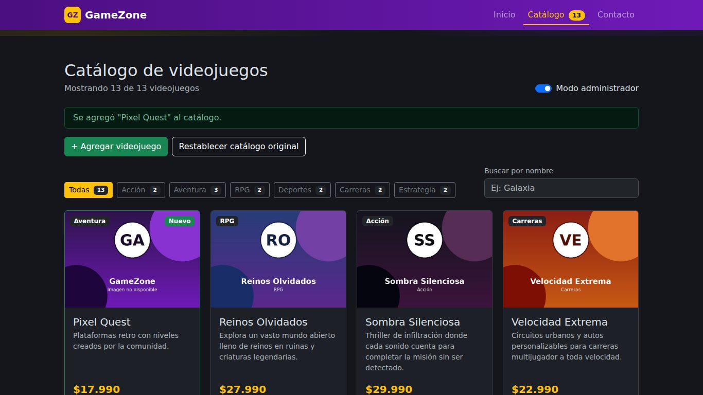 |

> Los cambios del modo administrador viven en el estado de React: al recargar la página el catálogo vuelve a su versión original.

### 4. Enviar el formulario de contacto

| Campo | Regla de validación |
|---|---|
| Nombre | Obligatorio, 3 a 60 caracteres, solo letras y espacios. |
| Correo electrónico | Obligatorio, formato `nombre@dominio.ext`. |
| Mensaje | Obligatorio, 10 a 500 caracteres (con contador). |

Los errores aparecen al salir de un campo o al intentar enviar. Con datos válidos se muestra **Enviando…** y luego la confirmación personalizada. El envío es simulado: no hay servidor.

| Errores | Envío exitoso |
|---|---|
| 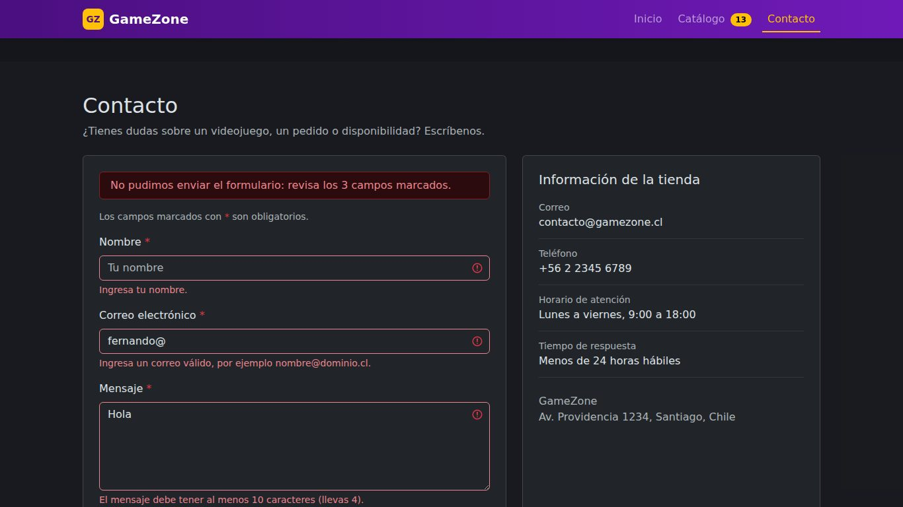 | 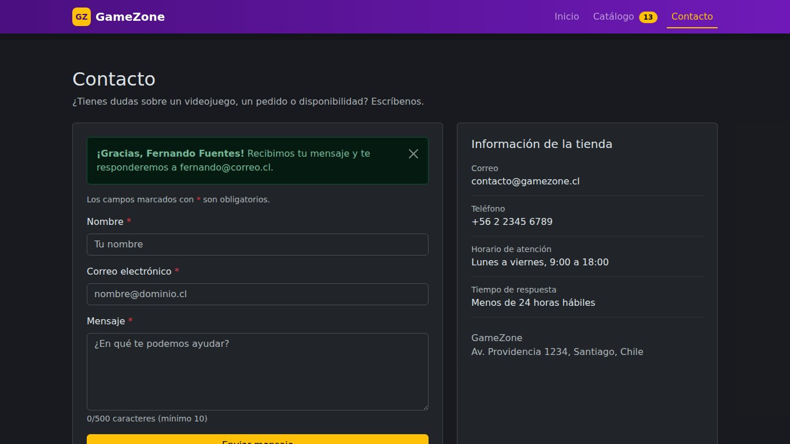 |

### 5. Probar el manejo de errores de carga

Agrega `?error` al final de la URL (por ejemplo `http://localhost:5173/?error`). La primera carga falla a propósito y el botón **Reintentar** recupera el catálogo.

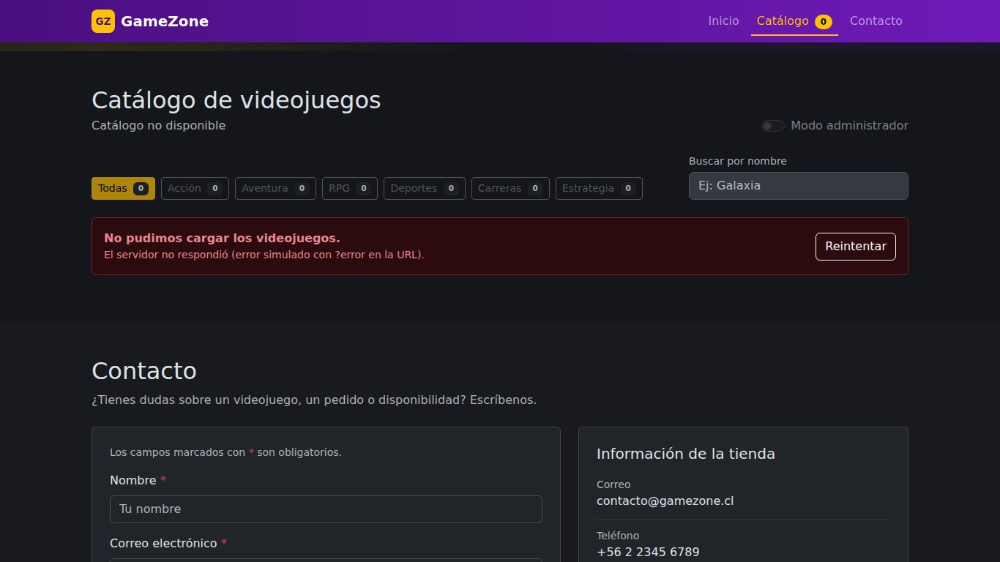

## Estructura del proyecto

```
Frontend.EFT.React/
├── index.html                  # HTML base: <div id="root"> donde React genera el sitio
├── package.json                # dependencias y scripts (dev, build, preview, deploy)
├── vite.config.js              # base: './' para GitHub Pages
├── public/
│   └── img/                    # portadas de los videojuegos e imagen por defecto
├── src/
│   ├── main.jsx                # punto de entrada: importa Bootstrap, estilos y monta <App />
│   ├── App.jsx                 # estado compartido y composición de las secciones
│   ├── data/
│   │   └── videojuegos.js      # OBJETO JavaScript con el catálogo y las categorías
│   ├── services/
│   │   └── videojuegosService.js  # entrega los datos de forma asíncrona (simula una API)
│   ├── hooks/
│   │   ├── useVideojuegos.js   # lista de juegos: carga (useEffect), agregar, eliminar
│   │   ├── useFormulario.js    # lógica reutilizable de formularios controlados
│   │   └── useSeccionActiva.js # sección visible con IntersectionObserver
│   ├── utils/
│   │   ├── validaciones.js     # validarContacto y validarVideojuego (funciones puras)
│   │   ├── formato.js          # precio en CLP, plural, normalizar texto
│   │   └── dom.js              # irASeccion, enfocarCampo, imagen por defecto
│   ├── components/
│   │   ├── layout/             # Navbar (header + nav) y Footer
│   │   ├── inicio/             # Hero (sección de inicio)
│   │   ├── catalogo/           # Catalogo, FiltroCategorias, ListaVideojuegos,
│   │   │                       # TarjetaVideojuego, FormularioVideojuego, EsqueletoCatalogo
│   │   ├── contacto/           # Contacto y FormularioContacto
│   │   └── comunes/            # CampoFormulario (reutilizado por ambos formularios)
│   └── styles/
│       └── app.css             # estilos propios: variables, Grid, Flexbox
├── pruebas/
│   ├── verificar_sitio.py      # pruebas automatizadas con Playwright
│   └── resultados.json         # resultado de la última ejecución
└── docs/
    └── capturas/               # imágenes usadas en este README
```

## Arquitectura de componentes, state y props

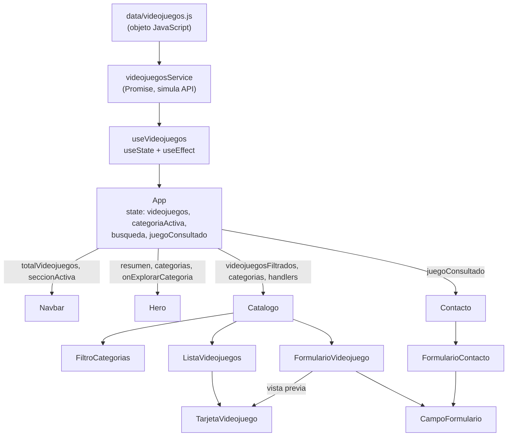

**Cómo fluye la información:**

- **State** en `App` (lista de videojuegos, categoría activa, búsqueda y juego consultado) porque lo usan varias secciones. Los estados que solo le importan a un componente quedan dentro de él: `menuAbierto` en Navbar, `modoAdmin` y `aviso` en Catalogo, `confirmando` en cada tarjeta, `estadoEnvio` en el formulario de contacto.
- **Props hacia abajo:** cada componente recibe solo los datos que muestra. Por ejemplo, `ListaVideojuegos` recibe la lista ya filtrada y genera una `TarjetaVideojuego` por elemento con `.map()`.
- **Funciones hacia abajo, eventos hacia arriba:** los hijos no modifican el estado directamente; llaman a funciones recibidas por props (`onCambiarCategoria`, `onAgregar`, `onEliminar`, `onConsultar`), y `App` actualiza el estado. React vuelve a renderizar solo lo que cambió.
- **Reutilización:** `TarjetaVideojuego` se usa en el catálogo y en la vista previa; `CampoFormulario` y el hook `useFormulario` se usan en los dos formularios; las validaciones son funciones puras independientes de React.

## Cumplimiento de los requerimientos del caso

| Requerimiento | Dónde se cumple |
|---|---|
| Página principal con los productos en venta | `Hero` + `Catalogo` en `App.jsx` |
| Tarjetas con imagen, nombre, precio y descripción | `TarjetaVideojuego.jsx` (card de Bootstrap) |
| Barra de navegación entre secciones (Inicio, Catálogo, Contacto) | `Navbar.jsx` (navbar de Bootstrap, sticky, menú móvil) |
| Formulario de contacto con nombre, email y mensaje validados antes de enviar | `FormularioContacto.jsx` + `utils/validaciones.js` |
| Etiquetas semánticas | `header`, `nav`, `main`, `section`, `article`, `aside`, `address`, `footer` |
| Flexbox o CSS Grid | `.grilla-juegos` (Grid), `.hero-contenido`, `.barra-filtros`, `.lista-contacto` (Flexbox) en `app.css` |
| Objeto JavaScript con nombre, categoría, precio, descripción e imagen | `src/data/videojuegos.js` |
| Tarjetas generadas dinámicamente | `ListaVideojuegos.jsx` recorre el estado con `.map()` |
| Filtrado por categoría con botones o menú desplegable | `FiltroCategorias.jsx` (ambos, según el tamaño de pantalla) |
| Mensajes de error si falta información o está mal ingresada | Errores por campo, resumen y foco automático en ambos formularios |
| Componentes separados: navegación, lista y formulario de contacto | `components/layout`, `components/catalogo`, `components/contacto` |
| State para agregar o eliminar videojuegos | `useVideojuegos.js` (`agregar`, `eliminar`, `recargar`) |
| Datos cargados dinámicamente desde un archivo o API | `videojuegosService.js` entrega el archivo de datos de forma asíncrona |
| Props que conectan las secciones | Filtro → lista, Consultar → contacto, agregar/eliminar → navbar, inicio y filtros |
| Sitio responsivo | Grillas de Bootstrap, CSS Grid con `auto-fill`, menú hamburguesa, filtro en `select` en móvil |
| README con instrucciones de instalación y uso | Este archivo |

## Pruebas y compatibilidad

### Pruebas automatizadas

`pruebas/verificar_sitio.py` usa [Playwright](https://playwright.dev/python/) para recorrer el sitio como un usuario. La última ejecución pasó **72 verificaciones** (ver `pruebas/resultados.json`): estructura semántica, carga y tarjetas, filtros y búsqueda, agregar/eliminar/restablecer, validaciones de ambos formularios, conexión catálogo → contacto, resaltado de la navegación, error de carga con reintento, responsividad, emulación de dispositivos y consola del navegador sin errores.

```bash
pip install playwright
playwright install chromium
npm run build && npm run preview          # en una terminal
python pruebas/verificar_sitio.py http://localhost:4173/   # en otra terminal
```

### Tamaños de pantalla

| Ancho | Columnas del catálogo | Navegación | Filtro | Desborde horizontal |
|---|---|---|---|---|
| 320 px | 1 | Menú hamburguesa | Menú desplegable | No |
| 360 px | 1 | Menú hamburguesa | Menú desplegable | No |
| 375 px | 1 | Menú hamburguesa | Menú desplegable | No |
| 414 px | 1 | Menú hamburguesa | Menú desplegable | No |
| 768 px | 2 | Barra completa | Botones | No |
| 1024 px | 3 | Barra completa | Botones | No |
| 1366 px | 4 | Barra completa | Botones | No |
| 1920 px | 4 | Barra completa | Botones | No |

### Dispositivos emulados en Chromium (pantalla, densidad de píxeles, user agent y toque)

| Dispositivo | Pantalla | Resultado |
|---|---|---|
| iPhone SE | 320 × 568 | Correcto |
| iPhone 13 | 390 × 664 | Correcto |
| Google Pixel 7 | 412 × 839 | Correcto |
| Samsung Galaxy S9+ | 320 × 658 | Correcto |
| iPad (7.ª generación) | 810 × 1080 | Correcto |
| iPad Pro 11 (horizontal) | 1194 × 834 | Correcto |

| Móvil | Menú móvil | Filtro en móvil | Tablet |
|---|---|---|---|
|  |  | 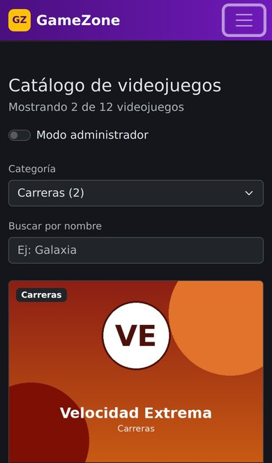 | 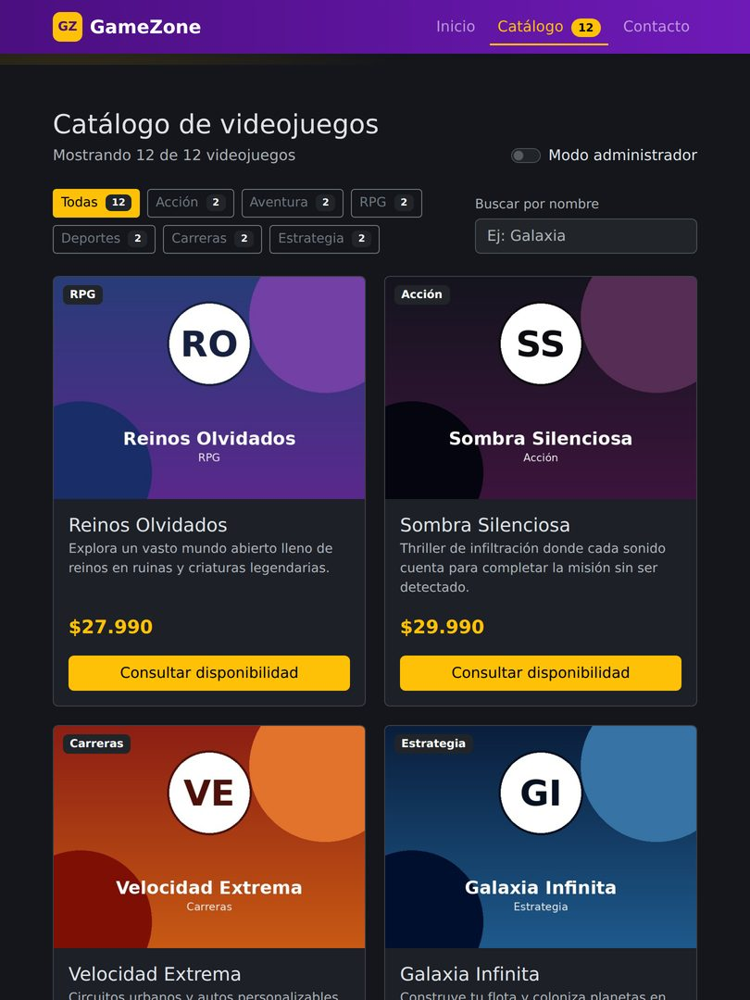 |

### Navegadores

| Navegador | Cómo se verificó | Resultado |
|---|---|---|
| Google Chrome / Chromium | Pruebas automatizadas (72 verificaciones) | Correcto |
| Microsoft Edge (Windows) | Revisión manual | Pendiente |
| Mozilla Firefox (Windows) | Revisión manual | Pendiente |
| Navegador del teléfono (Android o iPhone) | Revisión manual en el sitio publicado | Pendiente |

**Revisión manual (cada navegador):** abrir el sitio publicado, filtrar por una categoría, buscar un nombre, activar el modo administrador, agregar y eliminar un juego, usar "Consultar disponibilidad", enviar el formulario de contacto vacío y luego con datos válidos, y revisar que la consola (F12) no muestre errores. Al terminar, reemplazar "Pendiente" por "Correcto" o anotar lo encontrado.

El build de Vite apunta a navegadores modernos (Chrome 87+, Edge 88+, Firefox 78+, Safari 14+). El código no usa APIs experimentales, y `IntersectionObserver` se usa solo si el navegador lo soporta.

### Correcciones hechas a partir de las pruebas

- **Desborde horizontal en 320 px:** el correo del pie de página no cabía en dos columnas de 140 px. Se pasó a una columna en pantallas pequeñas y se agregó `overflow-wrap: anywhere` a direcciones y correos.
- **Resumen de inicio en laptops (1366 px):** las tres cajas del resumen se partían en dos filas; se ajustó la base de Flexbox para que queden en una sola fila.
- **Vista previa con URL incompleta:** mientras se escribía una URL de imagen, la vista previa pedía rutas inválidas al servidor (error 404 en consola). Ahora solo carga la imagen cuando la URL es válida.

## Publicación en GitHub Pages

El proyecto usa el paquete `gh-pages`: `npm run deploy` ejecuta primero `npm run build` (script `predeploy`) y después publica la carpeta `dist/` en la rama **`gh-pages`**.

1. Sube el código a la rama `main` del repositorio.
2. Ejecuta `npm run deploy`. Al terminar debe decir **`Published`**.
3. En GitHub → **Settings → Pages → Build and deployment**: *Deploy from a branch* → rama **`gh-pages`**, carpeta **`/ (root)`** → **Save**.
4. En uno o dos minutos el sitio queda en `https://<usuario>.github.io/<repositorio>/`.

`vite.config.js` usa `base: './'`: los archivos compilados se cargan con rutas relativas, así el sitio funciona dentro del subdirectorio del repositorio sin importar su nombre.

## Solución de problemas

| Problema | Solución |
|---|---|
| `"vite" no se reconoce como un comando…` | Falta instalar las dependencias: ejecuta `npm install` en la carpeta del proyecto. |
| La página publicada se ve en blanco | GitHub Pages está publicando `main` (código sin compilar). Selecciona la rama `gh-pages` en Settings → Pages. |
| `npm run deploy` falla con `Filename too long` (Windows) | Ejecuta `git config --global core.longpaths true`, luego `npx gh-pages-clean`, y vuelve a intentar. También ayuda trabajar en una ruta corta, como `C:\dev\`. |
| Abrir `index.html` con doble clic muestra una página vacía | Es lo esperado: usa `npm run dev` o `npm run preview`. |
| Al recargar desaparecen los juegos agregados | Es lo esperado: el catálogo se guarda en el estado de React, no en una base de datos. |

---

Proyecto académico — Desarrollo Frontend I (PFY2201), Duoc UC, 2026.
